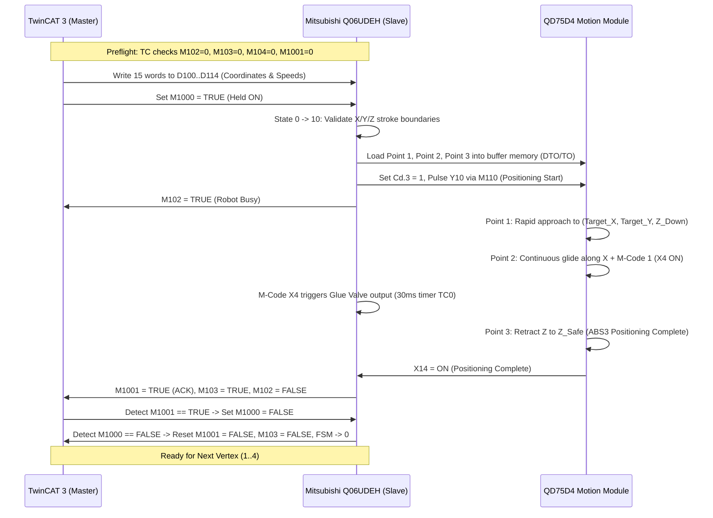

# PLC COORDINATE EXECUTION & TWINCAT3 INTERFACE READINESS AUDIT
**Date**: 2026-10-25  
**Workspace**: `E:\Orca\DATN`  
**Classification**: Technical Inspection & Commissioning Readiness Audit  
**Operating Boundary**: Zero live ADS/MC writes, zero PLC program activation or download, zero equipment motion.

---

## 1. Executive Summary & Audit Verdict

### Question:
> **Can the PLC receive coordinates from TwinCAT 3 and execute points, and what is missing?**

### Audit Verdict:
* **Source-Level Software Capability: YES (Fully Designed & Implemented in ST)**  
  The source code in TwinCAT 3 (`PLC/TwinCAT/DATN/PLC1/POUs/MAIN.TcPOU`, `FB_QD75CommandPublisher.TcPOU`, `FB_MelsecWrite.TcPOU`, `FB_MelsecRead.TcPOU`) and the Mitsubishi Q-Series handover logic (`PLC/Mitsubishi/Sources_20261019/Source/PLC_Q_Session2_Logic.st`) establish a complete, protocol-compliant, and mathematically sound interface for transmitting 4-vertex workpiece coordinates over MC Protocol 3E Binary TCP (port 5010), executing continuous-path interpolation across 3 points per vertex, pulsing a dispensing valve, and synchronizing state via a 4-phase handshake.

* **Machine-Level Physical Readiness: NO (STRICTLY BLOCKED / NOT COMMISSIONED)**  
  The system **CANNOT** execute coordinates on the physical gantry today. Live execution is locked out by hard-coded compile-time source constants (`cQueueMotionCommissioned = FALSE`), disarmed safety gates (`bLegacyMotionPublisherAllow = FALSE`), unverified live PLC-Q programs, uncalibrated vision and encoder offsets, and a **critical hardware wiring conflict** in the historical Mitsubishi ST code where `Y20` is assigned as the glue valve, directly clashing with physical machine wiring where `Y20..Y23` are the Servo Enablers and Brake Release, and `Y25` is the actual Glue Pump Trigger.

---

## 2. Verified Coordinate Symbols, Formats & Memory Mapping

### 2.1. Coordinate Block (TwinCAT 3 $\to$ Mitsubishi Q06UDEH)
Coordinates are packed into a 15-word contiguous data structure defined in `PLC/TwinCAT/DATN/PLC1/DUTs/ST_QD75_Command.TcDUT` and transmitted via Beckhoff `FB_MelsecWrite` to Mitsubishi D-registers `D100..D114` via MC Protocol 3E Binary TCP (Host Station Port `5010`):

| PLC Device | Variable Name | TwinCAT Type | Units / Conversion | Description / Functional Semantics |
|---|---|---|---|---|
| **D100 - D101** | `Target_X` | `DINT` (32-bit) | $0.1\ \mu\text{m}$ ($1\text{ mm} = 10,000$) | Interception coordinate $X$ at the moment Point 1 starts: $Target\_X = aCycleCorners[i].X + \Delta X_{enc} + V_{conv} \cdot t_{fly}$ |
| **D102 - D103** | `Target_Y` | `DINT` (32-bit) | $0.1\ \mu\text{m}$ ($1\text{ mm} = 10,000$) | Vertex coordinate $Y$: $Target\_Y = aCycleCorners[i].Y$ |
| **D104 - D105** | `Target_Z_Down` | `DINT` (32-bit) | $0.1\ \mu\text{m}$ ($4.0\text{ mm} = 40,000$) | Dispensing working height when needle descends |
| **D106 - D107** | `Speed_Approach` | `DINT` (32-bit) | $0.01\text{ mm/min}$ ($500\text{ mm/s} = 3,000,000$) | Rapid 3-axis interpolation speed for Point 1 (approach) and Point 3 (retract) |
| **D108 - D109** | `Speed_Sync` | `DINT` (32-bit) | $0.01\text{ mm/min}$ ($V_{conv}\text{ mm/s} \times 6,000$) | Synchronous conveyor-tracking speed along $X$ during dispensing (Point 2) |
| **D110 - D111** | `DeltaX_Sync` | `DINT` (32-bit) | $0.1\ \mu\text{m}$ ($V_{conv} \cdot t_{sync} \cdot 10,000$) | Distance conveyor travels while dispensing (default: $60\text{ ms} \times V_{conv}$) |
| **D112 - D113** | `Target_Z_Safe` | `DINT` (32-bit) | $0.1\ \mu\text{m}$ ($0.0\text{ mm} = 0$) | Safe retract elevation for needle before transit to next vertex |
| **D114** | `Vertex_Index` | `INT` (16-bit) | Integer ($1..4$) | Current vertex index ($1..4$) being executed; used for diagnostics and sequencing |

*Note on Endianness*: Mitsubishi Q-Series 32-bit integers (`DINT`) use standard little-endian word layout (low word at initial address $D_n$, high word at $D_{n+1}$).

### 2.2. Mitsubishi Feedback & Diagnostic Registers (PLC-Q $\to$ TwinCAT 3)
| PLC Device | Variable Name | Data Type | Units / Range | Functional Semantics |
|---|---|---|---|---|
| **D116 - D117** | `Target_X_Sync` | `DINT` | $0.1\ \mu\text{m}$ | Calculated end position of synchronous glide: $Target\_X + DeltaX\_Sync$ |
| **D120 - D121** | `dErrCode` | `DINT` | Error Code | Software diagnostic error: `501` (X limit), `502` (Y limit), `503` (Z limit), `901` (QD75 not ready) |
| **D122** | `Axis1_Error` | `INT` | QD75 Error | Axis 1 (X) hardware/parameter error code read from buffer `U0\G806` (`Md.23`) |
| **D124** | `Axis2_Error` | `INT` | QD75 Error | Axis 2 (Y) hardware/parameter error code read from buffer `U0\G906` (`Md.23`) |
| **D126** | `Axis3_Error` | `INT` | QD75 Error | Axis 3 (Z) hardware/parameter error code read from buffer `U0\G1006` (`Md.23`) |
| **D200 - D201** | `iState` | `DINT` | $0..50$ | Internal FSM state of the Mitsubishi tracking sequencer |

---

## 3. Handshake Protocol, Interlock Gates & ACKs

### 3.1. Handshake Bit Specification
The synchronization contract between TwinCAT 3 (Master) and Mitsubishi Q (Slave) uses dedicated M-relays. **M100 and M101 are strictly prohibited** because they are already used by the homing routine in the existing Mitsubishi `MAIN` ladder program.

| Device | Signal Name | Owner / Direction | Semantics |
|---|---|---|---|
| **M1000** | `Cmd_Start_Vertex` | TwinCAT $\to$ Q | Command to begin execution of the vertex in `D100..D114`. Must remain **HELD ON** until `M1001` is confirmed ON by TwinCAT. |
| **M1001** | `Ack_Vertex_Done` | Q $\to$ TwinCAT | Acknowledgment asserted ONLY after Point 3 (Z safe retract) is complete. De-asserted when TwinCAT lowers `M1000`. |
| **M102** | `Robot_Busy` | Q $\to$ TwinCAT | High during states $10..30$ (boundary checking, QD75 buffer load, and 3-point motion execution). |
| **M103** | `Robot_In_Position` | Q $\to$ TwinCAT | High during states $40..50$ (motion finished, needle at safe height, waiting for Master to drop `M1000`). |
| **M104** | `Robot_Alarm` | Q $\to$ TwinCAT | High if any QD75 axis alarm is active (`X8, X9, XA`) or if software boundary checks fail (`dErrCode <> 0`). |
| **M105** | `Cmd_Cycle_Reset` | TwinCAT $\to$ Q | Software abort/cancel request over network (NOT a hardware E-Stop). Aborts motion, forces FSM to 0, turns off glue valve. |

### 3.2. 4-Phase Handshake Sequence


### 3.3. Preflight Safety Gates (Code-Level Verification)

#### In TwinCAT (`FB_QD75CommandPublisher.TcPOU`):
1. **Socket Interlock (State 0, Lines 131–138)**:
   - `stSession.bConnected = TRUE` (MC TCP connection active).
   - `bProductValid = TRUE` (Valid tracked workpiece data present).
   - `stSession.bBusy = FALSE` (No concurrent MC Protocol transaction).
   - `bAbortCycle = FALSE`.
2. **PLC-Q Preflight Status Read (States 10–11, Lines 181–205)**:
   - Reads 3 contiguous bits: `M102` (Busy), `M103` (In-Position), `M104` (Alarm).
   - Rejects start if `M104 = TRUE` (Error code `904`).
   - Rejects start if `M102 = TRUE` or `M103 = TRUE` (Error code `905`).
3. **ACK Low-Level Verification (States 14–15, Lines 206–224)**:
   - Reads `M1001` to ensure previous cycle ACK has returned to `FALSE` (Error code `906` if still high).
4. **Coordinate Boundary Validation (State 20, Lines 225–256)**:
   - Vertex index: $1 \le nCurrentVertex \le 4$.
   - Speed envelopes: $0 < rConveyorSpeed \le 1000\text{ mm/s}$, $0 < rApproachSpeed \le 1000\text{ mm/s}$.
   - Glide duration: $0 < rSyncTime\_s \le 0.5\text{ s}$.
   - Mechanical Envelope Bounds:
     - $0.0 \le Target\_X \le 180.0\text{ mm}$ AND $(Target\_X + DeltaX\_Sync) \le 180.0\text{ mm}$.
     - $0.0 \le Target\_Y \le 170.0\text{ mm}$.
     - $0.0 \le Target\_Z\_Safe \le Target\_Z\_Down \le 52.0\text{ mm}$.
   - If any bound is violated, aborts with error code `501` without transmitting motion commands.

#### In Mitsubishi PLC-Q (`PLC_Q_Session2_Logic.st`):
1. **Drive Readiness Gate (State 0, Lines 63–70)**:
   - Evaluates `X0` (QD75 Ready), `NOT (XC OR XD OR XE)` (Axes 1, 2, 3 not busy), `NOT (X8 OR X9 OR XA)` (Axes 1, 2, 3 no error), and `NOT M105` (No abort).
   - If not ready when `M1000` rises, throws error `901` (`dErrCode := 901`), sets alarm `M104`.
2. **Secondary Software Boundary Check (State 10, Lines 87–96)**:
   - Independent verification of $X \in [0, 1800000]$, $Y \in [0, 1700000]$, $Z \in [0, 520000]$ (in $0.1\ \mu\text{m}$). Throws `501`, `502`, or `503` if out of bounds, preventing buffer load.

---

## 4. Point Execution State Machine (4 Points / Vertices per Workpiece)

Each physical product requires the execution of 4 vertices. For each vertex, the Mitsubishi QD75 module executes a 3-point positioning trajectory:

### 4.1. QD75 Positioning Buffer Points (Per Vertex)
* **Point 1: Rapid Interception (Buffer Offset `2000`)**
  * Control Method: `16#1503` (3-axis Linear Interpolation ABS3 + Continuous Path).
  * Target Coordinates: $X = Target\_X$ (D100), $Y = Target\_Y$ (D102), $Z = Target\_Z\_Down$ (D104).
  * Speed: `Speed_Approach` (D106, default $500\text{ mm/s}$).
  * M-Code: `0`.
  * Behavior: Fast diagonal flight descending into position immediately ahead of the moving part.
* **Point 2: Synchronous Dispensing Glide (Buffer Offset `2010`)**
  * Control Method: `16#1503` (3-axis Linear Interpolation ABS3 + Continuous Path).
  * Target Coordinates: $X = Target\_X + DeltaX\_Sync$ (D116), $Y = Target\_Y$ (D102), $Z = Target\_Z\_Down$ (D104).
  * Speed: `Speed_Sync` (D108, strictly matching conveyor linear speed $V_{conv}$).
  * M-Code: `1` (triggers QD75 M-code flag `X4` upon entering Point 2).
  * Behavior: Needle tracks precisely with conveyor; PLC-Q intercepts `X4`, asserts glue valve output for 30 ms (`TC0`), and clears M-code via buffer `Cd.7 = 1`.
* **Point 3: Safe Z-Retract (Buffer Offset `2020`)**
  * Control Method: `16#1500` (3-axis Linear Interpolation ABS3 + Positioning Complete).
  * Target Coordinates: $X = Target\_X + DeltaX\_Sync$ (D116), $Y = Target\_Y$ (D102), $Z = Target\_Z\_Safe$ (D112).
  * Speed: `Speed_Approach` (D106).
  * M-Code: `0`.
  * Behavior: Needle retracts vertically to $Z = 0.0\text{ mm}$; axis positioning complete flag `X14` fires.

### 4.2. TwinCAT `FB_QD75CommandPublisher` State Machine
| State | Name | Function / Activity | Exit Condition | Next State |
|---|---|---|---|---|
| **0** | `IDLE` | Awaits `fbStartEdge.Q` (rising edge of `bStartCycle` or `bAutoStartPulse`) | Preflight checks pass | **10** |
| **10** | `PREFLIGHT_READ_REQ` | Prepares read of `M102..M104` (Busy, InPos, Alarm) | `fbRead.bExecute` pulsed | **11** |
| **11** | `PREFLIGHT_READ_WAIT` | Evaluates `aRobotStatus` | No error & robot idle | **14** (or **99** on fault) |
| **14** | `ACK_CLEAR_READ_REQ` | Prepares read of `M1001` (ACK) | `fbRead.bExecute` pulsed | **15** |
| **15** | `ACK_CLEAR_READ_WAIT` | Confirms previous ACK is LOW | `bStatusBit == FALSE` | **20** (or **99** on fault) |
| **20** | `CALC_AND_WRITE_D` | Calculates drift $X_{target} = X_{corner} + \Delta X_{enc} + V \cdot t_{fly}$; packs 15 words; issues write to `D100..D114` | Boundary valid & write issued | **21** (or **99** on error 501) |
| **21** | `WAIT_WRITE_D` | Waits for MC Protocol write response for D100..D114 | `fbWrite.bDone` | **211** |
| **211** | `WRITE_M1000_ON` | Issues MC Protocol write: `M1000 = TRUE` | Write issued | **22** |
| **22** | `WAIT_M1000_ON` | Confirms M1000 written successfully | `fbWrite.bDone` | **30** |
| **30** | `WAIT_ACK_START` | Starts 10s watchdog `tonAck`; polls 20ms timer | Poll timer expired | **33** |
| **33** | `CHECK_ALARM_DURING` | Reads and verifies `M104 = FALSE` while robot moves | `M104 == FALSE` | **35** (or **90** on alarm) |
| **35** | `READ_M1001_REQ` | Issues read of `M1001` | Read issued | **31** |
| **31** | `WAIT_M1001_DONE` | Checks if `M1001` is asserted by PLC-Q | `M1001 == TRUE` | **32** (loop to 30 if FALSE) |
| **32** | `WRITE_M1000_OFF` | Detects ACK; issues write: `M1000 = FALSE` | `fbWrite.bDone` | **40** |
| **40** | `WAIT_RELEASE_START` | Starts 5s watchdog `tonRelease`; polls 20ms timer | Poll timer expired | **43** |
| **43** | `CHECK_ALARM_RELEASE` | Confirms no alarm during handshake drop | `M104 == FALSE` | **45** |
| **45** | `READ_M1001_RELEASE` | Issues read of `M1001` | Read issued | **41** |
| **41** | `CONFIRM_RELEASE` | Confirms PLC-Q dropped `M1001 = FALSE` | `M1001 == FALSE` | If $v < 4 \to$ **10** (next vertex)<br>If $v = 4 \to$ **0** (`bDone := TRUE`) |
| **70** | `MANUAL_WRITE` | Service mode: single manual write to D100 or M1000 | Write finished | **0** |
| **80** | `MANUAL_READ` | Diagnostics: read back M1001 | Read finished | **0** |
| **90–92** | `ABORT_SEQUENCE` | Emergency TCP cancel: writes `M105 = TRUE`, then `M1000 = FALSE` | Both confirmed | **99** (`bStopCommandConfirmed := TRUE`) |
| **99** | `FAULT_LATCHED` | Latched fault state; prevents restart until deliberate operator reset | `bResetFault` pulsed | **95** (resets M105, returns to 0) |

---

## 5. WPF & ADS Telemetry Synchronization Status

As verified in `Docs/GANTRY_WPF_TELEMETRY_SYNC_20261025.md` and `App/Vision/Dashboard.cs`, the WPF supervisory interface is strictly synchronized in a **READ-ONLY** posture.

### 5.1. Verified Telemetry Tags Exposed to WPF
| ADS Symbol Name | Data Type | Scope / Source | Direction | WPF Dashboard Destination |
|---|---|---|---|---|
| `MAIN.bPlcQConnected` | `BOOL` | `MAIN.TcPOU:16` | R | `DashGantryPlc.Text`, Overview Interlock indicator |
| `MAIN.bPlcQError` | `BOOL` | `MAIN.TcPOU:17` | R | Overview alarms, S1 Sensor edge log |
| `MAIN.nPlcQErrorID` | `UDINT` | `MAIN.TcPOU:18` | R | Tag Matrix table (`GANTRY` group) |
| `MAIN.bGlueCycleBusy` | `BOOL` | `MAIN.TcPOU:318` | R | `DashGantryState.Text` ("CYCLE IN PROGRESS") |
| `MAIN.bGlueCycleDone` | `BOOL` | `MAIN.TcPOU:319` | R | Overview cycle completion indicator |
| `MAIN.bGlueCycleError` | `BOOL` | `MAIN.TcPOU:320` | R | `DashGantryState.Text` ("GANTRY: FAULT") |
| `MAIN.nGlueCurVertex` | `INT` | `MAIN.TcPOU:322` | R | `DashGantryVertex.Text` ("Current vertex: X / 4") |
| `MAIN.nGlueErrorCode` | `INT` | `MAIN.TcPOU:324` | R | Error code diagnostic readout |
| `MAIN.nGlueCommErrorID` | `UDINT` | `MAIN.TcPOU:323` | R | Socket communication error ID |
| `MAIN.bStopCommandConfirmed` | `BOOL` | `MAIN.TcPOU:321` | R | Stop confirmation status, sensor edge log |
| `MAIN.nAutoDispatchState` | `INT` | `MAIN.TcPOU:178` | R | `DashGantryVertex.Text` (Dispatch state step) |
| `MAIN.bLegacyMotionPublisherAllow` | `BOOL` | `MAIN.TcPOU:258` | R | Safety gate status (WPF displays "PUBLISHER LOCKED") |
| `MAIN.bVisionFeedVerified` | `BOOL` | `MAIN.TcPOU:234` | R | Camera bridge verification flag |
| `MAIN.nQueueCount` | `INT` | `MAIN.TcPOU:264` | R | FIFO item count ($0..8$) |
| `MAIN.nQueueHeadProductID` | `UDINT` | `MAIN.TcPOU:265` | R | FIFO head item product ID |
| `MAIN.nQueueRealCompleted` | `UDINT` | `MAIN.TcPOU:185` | R | Count of products completed with 4 physical ACKs |
| `MAIN.rQueueHeadX_mm` | `LREAL` | `MAIN.TcPOU:272` | R | Predicted X position of head product |
| `MAIN.rQueueHeadY_mm` | `LREAL` | `MAIN.TcPOU:273` | R | Tracked Y position of head product |
| `MAIN.fbPublisher.rTargetX_mm` | `LREAL` | `FB_QD75CommandPublisher:54` | R | Calculated interception target X sent to D100 |
| `MAIN.fbPublisher.rTargetY_mm` | `LREAL` | `FB_QD75CommandPublisher:55` | R | Target Y coordinate sent to D102 |

### 5.2. Explicit Boundaries & Unmapped Signals (Zero Guesswork Contract)
1. **Actual Tool Center Point (TCP / Real-Time Coordinate Feedback)**:
   - Mitsubishi QD75 buffer memory `Md.20` (`U0\G800`, `U0\G900`, `U0\G1000` for Axes 1, 2, 3) is **NOT streamed to TwinCAT over MC Protocol**.
   - TwinCAT does not possess live axis position feedback.
   - WPF UI fields `S1X`, `S1Y`, `S1Z`, `S1Rz` and `Ov1X`, `Ov1Y`, `Ov1Z`, `Ov1Rz` explicitly display `--` (`UNAVAILABLE`) with label `TCP: NOT AVAILABLE IN PLC IMAGE`.
2. **Homed Status (`S1Homed`, `Ov1Homed`)**:
   - Homing is executed solely inside Mitsubishi ladder using internal pulses `M100/M101`.
   - No homing status bit is transmitted to TwinCAT. WPF displays `UNMAPPED` / `NO DATA`.
3. **Drive Ready (`S1Ready`, `S1Servo`)**:
   - `MAIN.bServo_Ready` belongs to the **Ezi-SERVO2 rotary stepper drive** (Degree), **not** the Mitsubishi QD75 gantry servo drives.
   - Actual QD75 drive ready is internal PLC-Q contact `X0`. WPF displays `UNMAPPED (QD75)` for `S1Ready` and `ROTARY OK` for `S1Servo`.

---

## 6. Detailed Missing Live Prerequisites & Blocker Matrix

Why can coordinates NOT be physically executed on the machine today? The blockers span five distinct layers:

### Layer A: TwinCAT 3 Compile-Time Constants & Hard Safety Locks
1. **`cQueueMotionCommissioned : BOOL := FALSE` (`MAIN.TcPOU:361`)**:
   - Declared as a **`VAR CONSTANT`**. It cannot be overwritten via ADS, HMI, or memory forced.
   - In `MAIN.TcPOU:801-802`, if `cQueueMotionCommissioned` is FALSE, `nAutoDispatchState` is forced to `100` (`Hard-coded offline commissioning lock`).
   - The FIFO sequencer will **never emit `bAutoStartPulse`** to trigger `fbPublisher`.
2. **`cLineAutoCommissioned : BOOL := FALSE` (`MAIN.TcPOU:363`)**:
   - Declared as a `VAR CONSTANT`. Prevents the HMI Line Master from accepting AUTO commands (`MAIN.TcPOU:450-452`, rejects with code `11`).
3. **`bLegacyMotionPublisherAllow : BOOL := FALSE` (`MAIN.TcPOU:258`)**:
   - Offline safety gate. In `MAIN.TcPOU:847`, `fbPublisher.bStartCycle` is hard-interlocked with `bLegacyMotionPublisherAllow`. It remains `FALSE` in source and runtime.
4. **`bVisionFeedVerified : BOOL := FALSE` (`MAIN.TcPOU:234`)**:
   - Gates the upstream camera tracking and exposure timestamp latching (`MAIN.TcPOU:1021, 1033`).

### Layer B: Mitsubishi PLC-Q Critical Hardware Wiring Conflict
1. **FATAL WIRING INCONSISTENCY IN HISTORICAL ST (`PLC_Q_Session2_Logic.st:200`)**:
   - In `PLC_Q_Session2_Logic.st:200`, the code assigns:
     ```iec
     Y20 := bValve_Open AND NOT M105; (* Van keo vat ly (Slot 1 QY40P) *)
     ```
   - **HOWEVER, confirmed physical machine wiring (`TWINCAT_MITSUBISHI_QD75_CONFIG_PENDING_20261021.md:40-49`) specifies**:
     - **`Y20` = Servo 1 Enable**
     - **`Y21` = Servo 2 Enable**
     - **`Y22` = Servo 3 Enable**
     - **`Y23` = Brake Release**
     - **`Y25` = Glue Pump Trigger**
   - **Hazard**: If the historical ST file were downloaded to the PLC-Q as-is, triggering a glue dispensing cycle would fire `Y20`, modulating the **Servo 1 Enable line** rather than the glue pump, potentially dropping servo torque under load!
   - **Remediation Required**: The ST logic must be updated to output to `Y25` (never `Y20`), and `Y20..Y23` must remain under dedicated, single-writer servo/brake enable ladder rungs in `MAIN`.
2. **Unverified PLC-Q Program State (Candidate GX Works2 Project)**:
   - `Test2_FROM_SESSION_20261017.gxw` in `PLC/Mitsubishi/Sources_20261019/GXWorks2/Candidates/` has not been reconciled against the live CPU via an **Online Read/Verify**.
   - It is unconfirmed whether the Tracking ST routine is registered in the CPU's scan execution program list (`Program Setting` in PLC Parameters).

### Layer C: Physical Mechanical & Axis Geometry Verification
1. **Z-Axis Coordinate Polarity & Stroke Safety**:
   - `PLC_Q_Session2_Logic.st:93` assumes $Target\_Z\_Down \ge Target\_Z\_Safe$ with limits $[0, 520000]$ ($0..52\text{ mm}$).
   - This assumes positive coordinate travel moves the needle downward toward the workpiece.
   - Physical QD75 axis direction, mechanical travel limits, and limit switches have not been verified under power.
2. **Glue Pump Actuator Characteristics**:
   - The ST code uses a 30 ms pulse (`TIMER_H_M(TC0, 3)`). It is unverified whether the physical dispenser controller requires an edge trigger, a sustained level, or has an auxiliary ready/done feedback.

### Layer D: Vision & Encoder Physical Calibration
1. **Zero Camera-to-Robot Offset (`rCameraToWorkStart_mm = 0.0`, `MAIN.TcPOU:236`)**:
   - Distance from the camera inspection point to the robot coordinate origin ($X=0$) is set to `0.0 mm`.
   - Without a physical measurement, the FIFO tracker cannot determine when a workpiece arrives in the robot workspace.
2. **Hardware Exposure Triggering vs Software Polling**:
   - Camera triggering is currently bench-simulated in C#. Physical camera strobe hardware wiring to latch the ST-5114 encoder count (`bCameraExposeTrigger`) is not installed.
   - Workpiece poses lack unique frame IDs, limiting FIFO association to a single in-flight exposure.

### Layer E: Electrical Safety Infrastructure
1. **Auxiliary E-Stop Feedback vs Safety Circuit**:
   - As documented in `PLC_README_ESTOP.md`, TwinCAT input `GVL_MD200_IO.bEStopFeedback` (ST-1228 DI0) is **auxiliary monitoring only**.
   - An independent, dual-channel hardwired safety relay circuit that directly removes power from the QD75 servo amplifiers and the MD200 inverter independently of Ethernet/software must be physically commissioned before live motion is authorized.

---

## 7. Safe, Step-by-Step Commissioning Roadmap

To transition coordinate execution from source capability to live machine operation, the following phased sequence must be executed under engineering supervision:

```
[ Phase 1: Electrical & Wiring Audit ]
  ├── Verify hardwired E-Stop cuts QD75 servo & MD200 power
  └── Audit Slot 1 QY40P wiring: Y20-Y22 (Servo En), Y23 (Brake), Y25 (Glue)
        │
[ Phase 2: Mitsubishi PLC-Q Online Reconciliation ]
  ├── GX Works2 Online Read/Verify against running CPU
  ├── Correct ST logic: Reassign glue valve to Y25 (remove Y20 write)
  └── Check QD75 Basic/Detailed Parameters & mechanical stroke limits
        │
[ Phase 3: Isolated Mitsubishi Bench Test (No TwinCAT) ]
  ├── Execute procedure in Session2_BenchTest_Without_TwinCAT.md
  ├── Write test vector to D100..D114 via GX Works2 Device Test
  └── Toggle M1000 manually; verify Point 1-2-3 motion, Y25 pulse, M1001 ACK
        │
[ Phase 4: Non-Motion Communication & Diagnostic Verification ]
  ├── Execute fbEchoWord and fbEchoBit (verify MC 3E binary TCP socket)
  └── Run FB_MelsecDebugXY4Pt (writes D100-D103, verifies readback, NO motion)
        │
[ Phase 5: Vision Trigger & Encoder Calibration ]
  ├── Measure physical distance rCameraToWorkStart_mm
  ├── Calibrate mm/count ratio on ST-5114 encoder
  └── Wire hardware camera exposure trigger to PLC input
        │
[ Phase 6: Supervised Single-Vertex Dry Run ]
  ├── Temporarily set bLegacyMotionPublisherAllow := TRUE under supervision
  └── Run single manual vertex test via fbPublisher.bStartCycle with robot jog limits
        │
[ Phase 7: Production Gate Activation ]
  └── Update cQueueMotionCommissioned := TRUE and compile release build
```

---

## 8. Summary Table: Software Capability vs Live Readiness

| Feature / Subsystem | Source Code Status | Machine Live Readiness | Primary Blocker / Reason |
|---|---|---|---|
| **MC Protocol 3E TCP Transport** | **IMPLEMENTED** (`FB_MelsecWrite/Read`) | **VERIFIED OFFLINE** | Port 5010 configured; requires live CPU ping/echo check |
| **Coordinate Packing (D100..D114)** | **IMPLEMENTED** (`ST_QD75_Command`) | **SOURCE READY** | 15-word payload matches Mitsubishi contract |
| **4-Phase Handshake (M1000/M1001)** | **IMPLEMENTED** (`FB_QD75CommandPublisher`) | **SOURCE READY** | M100/M101 homing conflict avoided; uses M1000/M1001 |
| **QD75 3-Point Interpolation (FSM)** | **IMPLEMENTED** (`PLC_Q_Session2_Logic.st`) | **NOT DEPLOYED** | Logic exists in ST file; not merged/verified in running GX project |
| **Dispense Output Trigger** | **INCORRECT IN ST** (`Y20`) | **FATAL WIRING CLASH** | ST writes `Y20` (Servo Enable); machine requires `Y25` (Glue Trigger) |
| **FIFO-to-Publisher Auto Dispatch** | **IMPLEMENTED** (`MAIN.TcPOU:796-840`) | **HARD COMPILE-LOCKED** | `cQueueMotionCommissioned = FALSE` (forces state 100) |
| **HMI Line Master Auto Start** | **IMPLEMENTED** (`MAIN.TcPOU:446-474`) | **HARD COMPILE-LOCKED** | `cLineAutoCommissioned = FALSE` (rejects with code 11) |
| **Motion Publisher Gate** | **IMPLEMENTED** (`MAIN.TcPOU:847`) | **LOCKED FALSE** | `bLegacyMotionPublisherAllow = FALSE` |
| **Camera Pose & Tracking Link** | **IMPLEMENTED** (`FB_CameraProductQueue`) | **UNVERIFIED / BENCH** | `rCameraToWorkStart_mm = 0.0`; no hardware exposure trigger |
| **Actual TCP Position Readback** | **NOT AVAILABLE** | **UNAVAILABLE** | QD75 `Md.20` is not streamed over MC Protocol to TwinCAT |
| **WPF Gantry Telemetry** | **IMPLEMENTED** (`PlateVision50.csproj`) | **READ-ONLY VERIFIED** | 20 unit tests pass; zero ADS write paths to motion registers |
